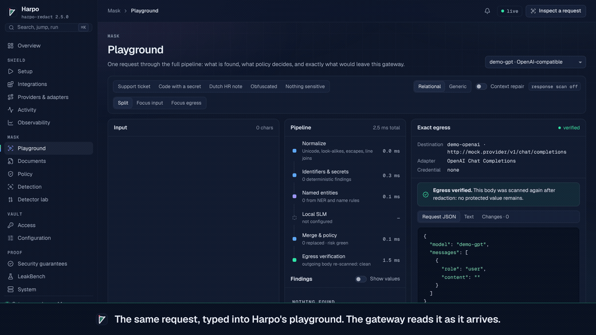
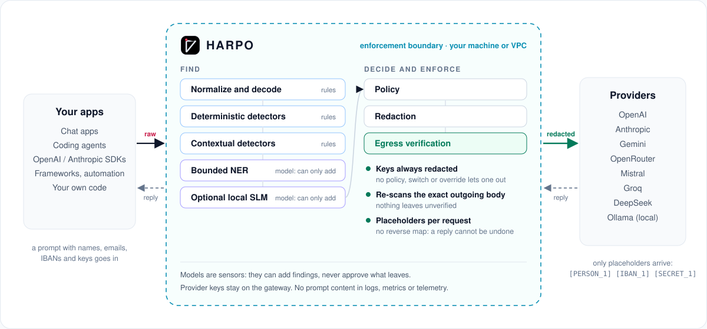
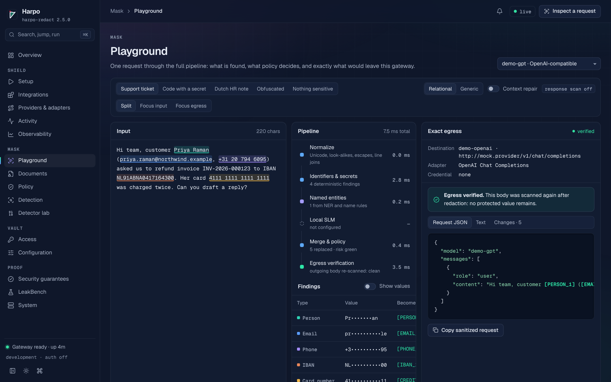
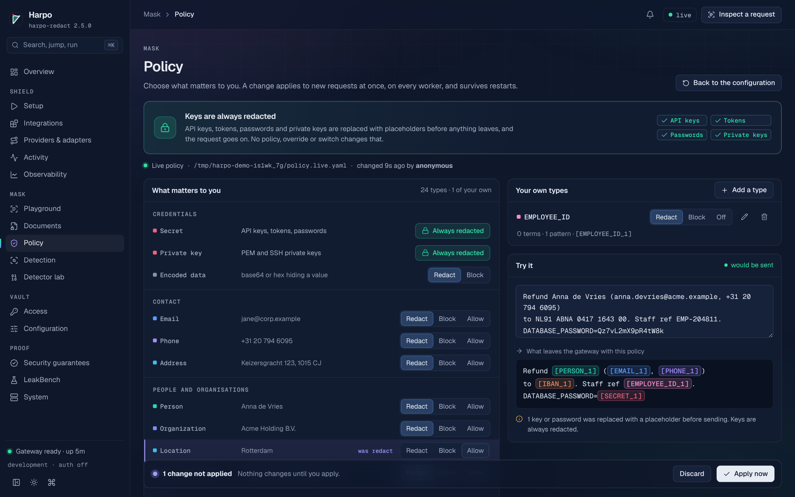
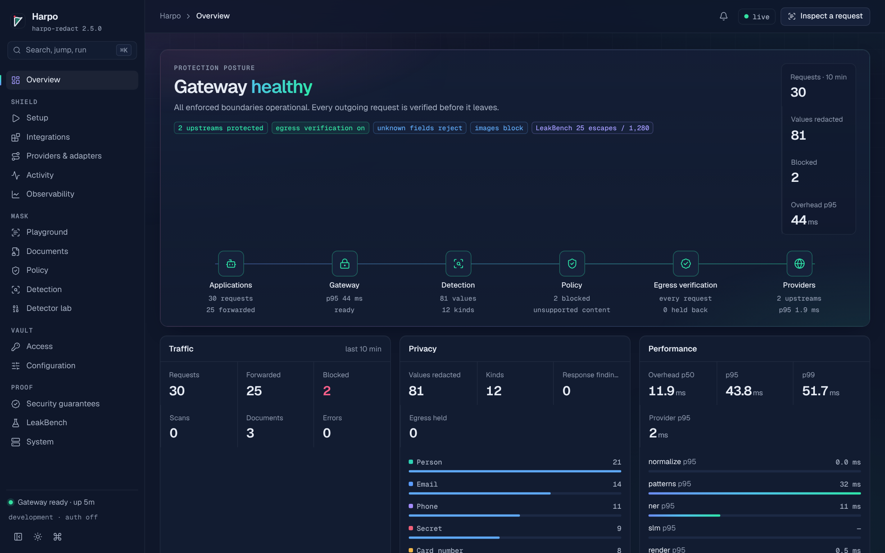
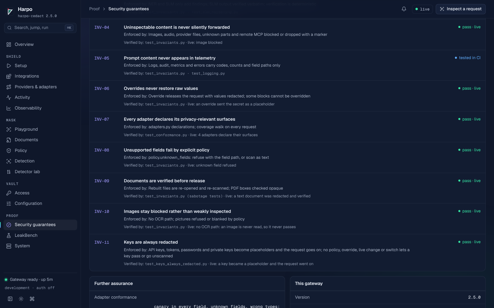
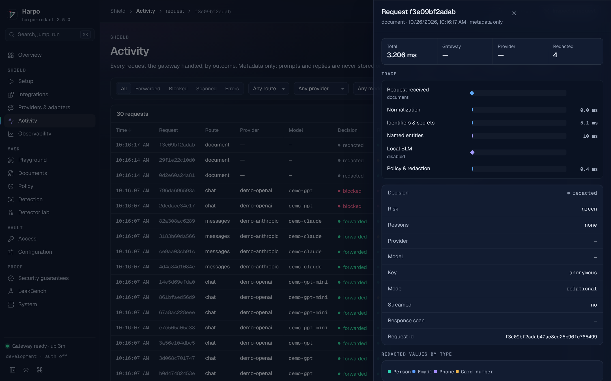
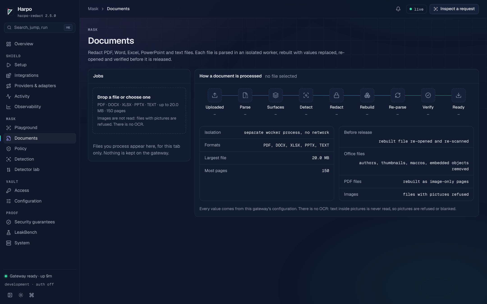

<div align="center">


# Harpo

### Your prompts go out. Your sensitive data doesn't.

**Harpo is an open-source, self-hosted privacy firewall for AI traffic.** It detects and removes secrets,
credentials, personal data and sensitive identifiers on your own infrastructure before a request reaches an external
model provider, then independently verifies the outgoing payload at egress.

[](LICENSE)
[](pyproject.toml)
[](docs/EXTERNAL_BENCHMARKS.md)
[](docs/LEAKBENCH.md)

[Quickstart](#quickstart) · [Before and after](#before-and-after) · [Benchmarks](#benchmarks) · [How it works](#how-it-works) · [Limitations](#known-limitations) · [Integrations](docs/integrations/README.md) · [Python SDK](docs/SDK.md) · [HTTP API](docs/API.md) · [Guide](docs/GUIDE.md) · [FAQ](docs/FAQ.md) · [Threat model](docs/THREAT_MODEL.md)

</div>

- **Open source and self-hosted.** Apache-2.0. Detection, policy and verification run on your machine or in your
  VPC; there is no Harpo cloud service.
- **Deterministic first.** Checksums, validated formats and 231 credential rules do the heavy lifting. Language
  models are sensors: they can add findings, never approve what leaves.
- **Verified at egress.** After redaction, the exact outgoing body is scanned again. A protected value that is still
  there blocks the request.
- **Provider-neutral.** OpenAI- and Anthropic-style APIs in front of OpenAI, Anthropic, Gemini, OpenRouter, Mistral,
  Groq, DeepSeek or a local Ollama. Your apps change their base URL and use a Harpo gateway key.
- **Keys never leave.** API keys, tokens, passwords and private keys are always redacted, whatever the policy says.
  Provider keys stay on the gateway; apps hold gateway keys.
- **No prompt content in telemetry.** Logs, metrics and audit lines carry counts, codes and timings. Placeholders are
  numbered per request and there is no reverse map.
- **Optional local semantic layer.** Add a local model (an SLM through Ollama) for context-dependent values the rules
  cannot see, behind the same enforcement boundary.

<div align="center">

</div>

## Quickstart

Three ways to use it, one engine underneath:

| | For | Start with |
| --- | --- | --- |
| **CLI and demo** | Trying it; scanning text and files from a shell | `harpo demo`, `harpo scan`, `harpo redact-file` |
| **Gateway** | The enforcement boundary between your applications and the providers | `harpo serve`, the boot scripts, Docker |
| **Python SDK** | Harpo inside your own code, or a gateway driven from it | `from harpo_redact.sdk import Harpo` ([docs/SDK.md](docs/SDK.md)) |

**See it work in two minutes, with no accounts or keys.** `harpo demo` runs the gateway, the console and a fake
provider that echoes exactly what it receives. Python 3.12 or newer; Harpo installs from its release tag on GitHub
(or from a clone: `python -m pip install .`):

```bash
pip install "harpo-redact @ git+https://github.com/levilausberg-png/harpo-redact@v2.5.0"
harpo demo                      # console on http://127.0.0.1:8080; Ctrl+C stops it
```

Names need spaCy's English model, which pip cannot bring along: `harpo demo` prints the one-line, hash-checked
install. The boot scripts and the Docker image include it.

<table>
<tr><th>Linux and macOS</th><th>Windows (PowerShell)</th></tr>
<tr><td>

```bash
git clone https://github.com/levilausberg-png/harpo-redact
cd harpo-redact
./boot.sh          # first run asks for your provider and key
./stop.sh
```

</td><td>

```powershell
git clone https://github.com/levilausberg-png/harpo-redact
cd harpo-redact
.\boot.cmd         # or .\boot.ps1 (PowerShell); double-click boot.cmd
.\stop.cmd         # or .\stop.ps1 (PowerShell)
```

</td></tr>
</table>

The boot scripts create a private `.venv`, install the gateway and its hash-checked models, ask where requests should
go and for that provider's key (stored in `.harpo/.env`, readable only by you), start the gateway, run the self-test
and open the console. If Ollama is installed they also load a local model (`phi3` by default; `--no-slm` skips it),
and without Ollama they go on without one. Every option: [the guide](docs/GUIDE.md#one-command-the-boot-scripts).

**Docker**, with a ChatGPT-style chat app already wired to the gateway:

```bash
git clone https://github.com/levilausberg-png/harpo-redact && cd harpo-redact
docker compose -f docker-compose.demo.yml up --build    # console on :8080, Open WebUI on :3000
docker compose -f docker-compose.demo.yml down
```

**Your own provider.** `harpo init` writes `config/harpo.yaml` for OpenAI, Anthropic, Gemini, OpenRouter, Mistral,
Groq, DeepSeek or Ollama and prints a gateway key (only its hash is stored). The console's **Setup** page does the
same with live checks.

```bash
harpo init                      # or: harpo init --provider anthropic --yes
export OPENAI_API_KEY=sk-...    # stays on the gateway; your apps only hold the gateway key
harpo serve                     # reads ./harpo.yaml or config/harpo.yaml; Ctrl+C for a clean shutdown
```

**Keys.** Your provider's key (`sk-...`) is configured on the gateway, never in your app: the boot scripts keep it
in `.harpo/.env`; with `harpo serve`, set it in the gateway's environment (`export OPENAI_API_KEY=sk-...`).

Your app gets a Harpo gateway key (`harpo_...`) instead: `harpo init` prints it; the boot scripts save it in
`.harpo/gateway-key.txt` and copy it to your clipboard.


Then change one line in your app:

```python
# OpenAI-compatible: the OpenAI SDKs, LangChain, LlamaIndex, most tools
client = OpenAI(base_url="http://localhost:8080/v1", api_key="harpo_...")    # the gateway key, not your sk-... key
# Anthropic-compatible: the Anthropic SDKs, Claude Code
client = Anthropic(base_url="http://localhost:8080", api_key="harpo_...")
```

```bash
# in your app's environment (not the gateway's)
export OPENAI_BASE_URL=http://localhost:8080/v1     # OpenAI SDKs and most tools
export OPENAI_API_KEY=harpo_...                     # the gateway key, not your sk-... key
export ANTHROPIC_BASE_URL=http://localhost:8080     # Anthropic SDKs, Claude Code
export ANTHROPIC_API_KEY=harpo_...                  # Claude Code: ANTHROPIC_AUTH_TOKEN
```

**From Python code.** The SDK runs the same engine in your process, or drives a running gateway
([docs/SDK.md](docs/SDK.md), [examples](examples/python/sdk)):

```python
from harpo_redact.sdk import GatewayClient, Harpo

with Harpo() as harpo:                                    # the gateway's own pipeline, in-process
    harpo.redact("Mail jane.doe@example.com")              # 'Mail [EMAIL_1]', or BlockedError if the policy blocks

with GatewayClient("http://localhost:8080", api_key="harpo_...") as gateway:
    gateway.scan("Mail jane.doe@example.com").findings     # what the gateway finds, and where
```

## Before and after

A request an app sends through `harpo demo` (every value invented), and what the provider received, unedited:

```text
Customer Maria Jansen (maria.jansen@northwind.example, +31 6 1234 5678) was charged twice on card 4111 1111 1111 1111 and wants the refund on IBAN NL91 ABNA 0417 1643 00.
The refund job uses OPENAI_API_KEY=sk-proj-Qz7vL2mX9pR4tW8kH3nB6yC1dF5gJ0aE and returns 401.
Draft a reply to her and tell me what is wrong.
```

```text
Customer [PERSON_1] ([EMAIL_1], [PHONE_1]) was charged twice on card [CREDIT_CARD_1] and wants the refund on IBAN [IBAN_1].
The refund job uses OPENAI_API_KEY=[SECRET_1] and returns 401.
Draft a reply to her and tell me what is wrong.
```

The response carries `x-harpo-redactions: 6` and `x-harpo-risk: yellow` (a key was redacted). The model still knows
who is who: `[PERSON_1]` stays `[PERSON_1]` across the request, and its reply comes back with the same placeholders.
Nothing maps them back to the values, so a reply cannot be turned into your data by anyone, the gateway included.

## Benchmarks

Measured, not promised: Harpo is run on public datasets it was not built against, baseline first and blind, with
every round and its hashes in [docs/EXTERNAL_BENCHMARKS.md](docs/EXTERNAL_BENCHMARKS.md). Datasets with one split
are cut in halves: fixes are made on the dev half, the holdout half is only counted. Harpo 2.5.0 has the detection
of the third hardening round; default configuration (the Docker image's).

| Benchmark | What it tests | Result, all documents | Holdout half |
| --- | --- | --- | --- |
| [ProwlBench 2.0](https://github.com/Lercas/prowlbench) | Secrets in code, wikis, tickets, logs and chat, in English and seven more languages (24,603 cases) | **F1 0.941** (precision 0.946, recall 0.936), scored by ProwlBench's own runner | F1 0.939 |
| Nemotron-PII | Personal data, 100,000 documents, 524,291 in-scope values | **94.8% fully removed** (95.3% at least partly), 2.3% collateral | 94.8% |
| OpenPII (ai4privacy) | Personal data in some thirty languages, 10,000 documents, 51,953 values | **76.8% fully removed** (79.1%), 5.1% collateral | 76.6% |
| RedactionBench | Documents to redact, 200 documents, 16,988 mandatory spans | **88.0% removed** (88.6%), 3.6% collateral, R-Score 0.460 | 81.3% |
| RegionBench (Harpo's own) | Dutch, US and EU identifiers, 14,764 generated values in 2,480 documents | **99.1% removed**, 5.5% of look-alikes damaged | 97.1% |
| LeakBench (Harpo's own) | 1,280 values under 18 attacks in five languages, plus traps | **98.0% recall**, 0.18% of text damaged | |

- On ProwlBench, F1 0.941 is ahead of every row its README reproduces from a clean checkout (the best scores 0.883;
  gitleaks 0.573). A research-only row, which needs models outside the repository and carries a disclosed
  train/test overlap, reports 0.962. Harpo's row comes from ProwlBench's own runner; it has not been submitted.
- *Fully removed* means every letter and digit of a value was redacted. *Collateral* is the share of text outside the
  labelled values that was redacted: an upper bound on over-redaction, since the datasets do not label everything
  Harpo protects (organisations, for one).
- OpenPII and Nemotron-PII rank models on a different metric; no rank is claimed on either. RegionBench and LeakBench
  are Harpo's own benchmarks: useful for regressions and region coverage, not independent evidence.
- All 25 LeakBench escapes are names (20 in leetspeak, 5 in lowercase); every other category has none. The
  [redaction matrix](tests/redaction_matrix.py) puts 60 value types through 31 shapes each (JSON, CSV, YAML, XML,
  tool-call arguments, base64, hex, look-alike letters, right-to-left overrides) through the real proxy: all 1,860
  cases pass, and 276 near misses arrive unchanged.

<p align="center"></p>

## How it works

Harpo sits between your applications and the provider, as a reverse proxy that speaks both API styles:

1. **Normalize and decode.** Unicode tricks, look-alike letters, zero-width characters, base64, hex, URL, HTML and
   JSON escapes, values split over lines or spaced out are read in repaired views.
2. **Deterministic detectors.** Cards pass Luhn and issuer checks, IBANs mod-97, phones libphonenumber, 17 national
   ID schemes their checksums; credentials use 231 rules (221 from gitleaks) plus passwords in prose, Basic auth and
   seed phrases.
3. **Contextual detectors.** After the word that names it, in some thirty languages, a value's shape is enough: a
   JSON key, a CSV header or a form label says what its value is.
4. **Bounded NER.** spaCy models find names, places and organisations per language. They can only add findings.
5. **Optional local SLM.** A local model can add context-dependent findings; each one is verified against the text.
6. **Policy.** Redact, block or allow per type, plus your own types. Keys are always redacted.
7. **Redaction.** Values become numbered placeholders, consistent within the request.
8. **Egress verification.** The exact outgoing body is scanned again with the deterministic layers; a hit blocks the
   request.

| Part | What it does |
| --- | --- |
| **Harpo-Shield** | The proxy: takes each request in the OpenAI or Anthropic format, routes it to your provider, and verifies the outgoing body before it leaves. Every field of a request is declared by its adapter; anything undeclared is refused (or scanned, if you choose). |
| **Harpo-Mask** | Finds and replaces: decoding, validated patterns, the credential rules, NER, your own types, and the policy that decides. |
| **Harpo-Vault** | What never leaves: provider keys stay on the gateway and go only to their own provider; apps hold gateway keys, stored as hashes; placeholders are numbered per request with no reverse map. |

## What it protects

| Family | Examples |
| --- | --- |
| Credentials, always on | API keys and tokens (221 gitleaks rules plus Harpo's own), private keys, passwords in prose and config, Basic auth, connection strings, seed phrases, keys inside base64 and escapes |
| Contact and payment | Email addresses (also spelled out or obfuscated), phone numbers, payment cards, IBANs |
| Identity numbers | US SSN, Dutch BSN, UK NINO and 17 checked national and tax ID schemes; passports, licences and account numbers after the word that names them |
| Region packs | Netherlands, United States and European Union identifiers, each listed with how it is found in [docs/REGIONS.md](docs/REGIONS.md) |
| Names, places, organisations | NER per language, name rules (greetings, titles, signatures, Chinese, Japanese and Korean family names), every later mention of a found name |
| Addresses | Street addresses in 30+ languages, postcodes with their town, Chinese, Japanese and Korean addresses by their units |
| Devices, crypto and machine formats | IP and MAC addresses, IMEI, VINs, crypto wallet addresses, user ids in URLs and logs, HL7 fields, passport machine-readable zones |
| Your own | Custom types with terms and RE2 patterns: `[EMPLOYEE_ID_1]`, `[PROJECT_1]` |

Every family has one switch, in the configuration file or live on the Policy page:
[docs/LIBRARY.md](docs/LIBRARY.md) lists them all.

## Works with what you already use

Every integration is two settings: the base URL and the gateway key. Copy-paste configuration for each is in
[docs/integrations](docs/integrations/README.md) and in the console, with your address and key filled in.
✓ means the snippet runs end to end against the gateway in [`tools/verify_integrations.sh`](tools/verify_integrations.sh).

| Chat apps | Coding agents | SDKs | Frameworks | Automation | Providers |
| --- | --- | --- | --- | --- | --- |
| Built-in playground ✓ | Claude Code | OpenAI Python ✓ | LangChain ✓ | n8n | OpenAI |
| Open WebUI | OpenAI Codex CLI | OpenAI Node ✓ | OpenAI Agents SDK ✓ | Dify, Flowise | Anthropic |
| LibreChat | Continue | Anthropic Python ✓ | LlamaIndex | | Google Gemini |
| LobeChat | Cline, Roo Code | Anthropic TypeScript ✓ | CrewAI | | OpenRouter |
| AnythingLLM | Aider | Vercel AI SDK ✓ | LiteLLM | | Mistral, Groq, DeepSeek |
| Jan, Chatbox, Msty | Zed, Cursor* | curl and HTTP ✓ | | | Ollama (local) |

With OpenRouter, the gateway also enforces provider routing: by default only providers that do not store prompts,
optionally zero-retention endpoints only, and fallback models limited to the ones you allow.

*Cursor calls custom endpoints from its own servers, so the gateway cannot protect prompts from Cursor itself. The
ChatGPT, Claude and Gemini consumer apps cannot be routed through any proxy; use the playground or a self-hosted chat
app with the same models instead.

## The control plane

The console is served by the gateway itself and makes no external requests.

<table>
<tr>
<td width="50%"><br><b>Playground.</b> Your input, every pipeline stage with its timing, and the exact request that would leave, verified.</td>
<td width="50%"><br><b>Policy.</b> Redact, block or allow each type, add your own, try a draft, apply it without a restart.</td>
</tr>
<tr>
<td><br><b>Overview.</b> Protection posture, the request path stage by stage, traffic, privacy and performance: counts and timings, never content.</td>
<td><br><b>Guarantees.</b> Eleven invariants with their evidence, and a live self-test that runs canaries through the real request path.</td>
</tr>
<tr>
<td><br><b>Activity.</b> Every request with its decision, risk, types and stage timings; prompts and replies are never stored.</td>
<td><br><b>Documents.</b> PDF, Word, Excel, PowerPoint and text files, rebuilt and re-scanned before release.</td>
</tr>
</table>

## Deployment

- **Docker Compose** (`docker compose up -d --build`): the image runs as a non-root user on a read-only root
  filesystem with no capabilities, and keeps live policy changes on a volume. Provider keys come from environment
  variables; TLS terminates at your ingress or in the gateway.
- **Production guards.** In production mode the gateway refuses to start without gateway keys, with plain-HTTP
  upstreams, without a provider key or with debug logging. `harpo check-config` explains each problem.
- **Operations.** `/healthz`, `/readyz` and Prometheus `/metrics`; JSON logs and one audit line per request, without
  content.

The steps, from gateway keys to TLS: [Production deployment](docs/GUIDE.md#production-deployment).

## Maximum-assurance mode

The default is deterministic and contextual detection plus bounded NER. For the highest assurance, keep the same
enforcement boundary and add a local semantic model:

```yaml
detection:
  slm:
    enabled: true
    base_url: http://ollama:11434          # docker compose --profile slm runs Ollama on an internal network
    model: llama3.2:3b                      # any model served through Ollama's API
    on_failure: fail_closed                 # refuse requests while the model is unavailable (degrade: continue without it)
    # model_digest: sha256:...              # pin the exact model
```

The optional local semantic layer, a small local language model or a specialised privacy model served through
Ollama's API, is designed to reduce residual false negatives for context-dependent or semantically ambiguous
sensitive content. It is an additional sensor, not the decision-maker: its findings are
verified against the text, it can only add redactions, and Harpo's policy and deterministic egress verification still
decide what leaves. What it adds depends on the model you run; it is not part of the published numbers. The boot
scripts set it up with Ollama (`phi3` by default; `--strict` fails closed).

## Policy and configuration

Every type has an action: **redact** (a placeholder), **block** (stop the request and say why) or **allow** (send it
as written). Change it on the console's Policy page, try a sample against the draft, and apply: the next request uses
it, on every worker, without a restart. The same lives in the configuration file:

```yaml
policy:
  entities: {US_SSN: {action: block}, ORGANIZATION: {action: allow}}
detection:
  custom_types:
    - {name: EMPLOYEE_ID, patterns: ['\bEMP-\d{6}\b']}
    - {name: PROJECT, terms: [Project Bluefin], action: block}
```

Keys are the one exception: API keys, tokens, passwords and private keys are always redacted and the request goes
on; no policy, switch or override changes that ([INV-11](docs/INVARIANTS.md)). Dates are detected and allowed by
default. Every option is in [`config/harpo.example.yaml`](config/harpo.example.yaml); details in
[Choose what matters](docs/GUIDE.md#choose-what-matters).

## Security invariants

Eleven properties, each enforced by a named mechanism and by tests that try to break it
([docs/INVARIANTS.md](docs/INVARIANTS.md)), among them: no raw blocked value crosses the boundary; no reverse
pseudonymization map outlives a request; probabilistic layers can never authorize egress; uninspectable content is
never silently forwarded; prompt content never appears in logs, metrics or errors; keys are always redacted. A
conformance suite puts a canary in every field of realistic requests for each provider format, and the console's live
self-test runs canaries through the running gateway on demand. Security reports: [SECURITY.md](SECURITY.md).

## Documents and files

PDF, Word, Excel, PowerPoint and text files (txt, md, csv, json, xml, html, yaml, logs, source) go through
`POST /v1/documents/redact`, `harpo redact-file`, the SDK's `redact_document()`, or the console's Documents page. Office
and text files are edited in place so formatting survives; PDF pages are re-rendered as images with the values blacked
out, so nothing sits under a box. Every file is re-opened and re-scanned before it is released, and what cannot be
inspected (pictures, scanned pages, macros, encrypted files) is refused rather than passed through. See
[Documents](docs/GUIDE.md#documents-pdf-word-excel-powerpoint-and-text-files).

## Known limitations

Harpo removes what it detects. Know what it does not:

- **Names are the weak spot.** All 25 LeakBench escapes in the default configuration are names, in leetspeak or
  lowercase; nicknames get missed too. Egress verification re-checks with the deterministic layers, so it cannot
  re-find a missed name; the optional local model is the layer for them, and its quality depends on the model you
  configure.
- **Precision and recall trade off on ambiguous values.** Generated identifiers without a checksum are protected only
  after a word that names them (76.8% of OpenPII's in-scope values are fully removed), and some products, events and
  organisations are over-redacted (2.3% to 5.1% collateral on the three personal-data sets). `policy.allow_terms`
  takes public terms.
- **No images, audio or OCR.** Images in chat are blocked by default (or dropped); pictures and scanned pages in
  documents are refused (or blanked).
- **Streamed replies are not scanned.** Requests are always scanned, streamed or not. Response scanning is off by
  default and covers non-streamed answers only; streamed ones are marked `x-harpo-response-scan: not_scanned_stream`.
- **Benchmarks are not your traffic.** The numbers above hold for the documented configuration on those datasets.
  Put your own invented data through the playground before you rely on it.
- **Not detected yet:** special-category data (health, religion, ethnicity, orientation) and combinations of harmless
  facts that identify someone together.
- **Allow means allow.** An administrator can set any type except keys and encoded data to `allow`, and it is then
  sent as written.
  Changes made in the console are audited with the key that made them.
- **Rate limits are per gateway process**, not shared across replicas.
- **No independent security audit yet.** Evaluate it against your own threat model; ours, with what Harpo does not
  cover, is in [docs/THREAT_MODEL.md](docs/THREAT_MODEL.md).

The full list: [Known limits](docs/GUIDE.md#known-limits). **Found a bypass?** Report a way past a protection that
should have held privately through [SECURITY.md](SECURITY.md); a kind of value Harpo does not catch yet is welcome as
a public *Detection miss* issue, with invented values.

## Benchmark methodology

Each external benchmark starts with a blind baseline: the release before any hardening (2.4.0) run once and recorded
as it was. Which labels count was fixed before any result was seen. Fixes are made on the dev half of each dataset
and judged on the holdout half; every round is a frozen build, identified by the sha256 of its installed package,
run on files identified by their sha256, with the harness in [`bench/external`](bench/external) and every result in
`bench/external/results/`, next to the baseline and never over it. ProwlBench is scored by its own runner, unchanged.
The full record, including what did not improve: [docs/EXTERNAL_BENCHMARKS.md](docs/EXTERNAL_BENCHMARKS.md).

## Contributing, security and licence

Detection misses are the most valuable contribution: open a *Detection miss* issue with an invented example, and it
becomes a regression test so the fix stays fixed. See [CONTRIBUTING.md](CONTRIBUTING.md) and the
[good first issues](https://github.com/levilausberg-png/harpo-redact/labels/good%20first%20issue). Security reports go
through [SECURITY.md](SECURITY.md), never public issues.

Open source under the [Apache License 2.0](LICENSE): use, modify, embed and redistribute it, commercially included,
with an explicit patent grant. Summary: [LICENSING.md](LICENSING.md). Third-party components:
[THIRD_PARTY_NOTICES.md](THIRD_PARTY_NOTICES.md).

*Harpo is named after Harpocrates, the god of silence: what passes through stays sub rosa
([the brand](docs/BRAND.md)).*
