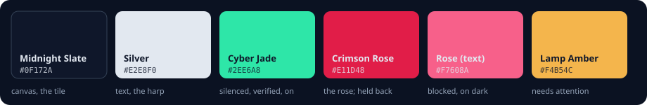

<div align="center">


# Harpo, the brand

</div>

## The name

**Harpo** is the product. **harpo-redact** is the repository, the Python package and the container image; **harpo**
is the command.

Harpocrates was the Hellenistic god of silence, secrets and confidentiality, shown with a finger to his lips. Cupid
gave him a rose to keep the affairs of the gods quiet, and the rose has meant secrecy ever since. A rose carved
above a council table meant that what was said *sub rosa*, under the rose, stayed in the room. The name also nods to
Harpo Marx, who never spoke a word on screen.

That is the job: what you say to a model stays sub rosa. The model gets the conversation; your names, numbers and
keys stay in the room.

Use the nod to Harpo Marx in the name only. Do not use his likeness or suggest any endorsement. "Harpo" is also used
by other companies in other fields, so check the name for your own trademark filings.

## The mark

A harp whose strings are a gate: traffic passes through, and the values it carries are held back. A heraldic
five-petal rose, the rose of sub rosa, sits at the crown.

| | Mark | Use it for |
| --- | --- | --- |
|  | **Primary**: the harp on a Midnight Slate tile | app icon, favicon, README, social cards |
|   | **The harp alone**, silver or slate | on slate or on white, when a tile would be one box too many |
|  | **Cyber-shield**: the harp set in a crest | security pages, badges, the guarantees |
|  | **Monolith**: one heavy silhouette, strings cut out | stickers, merch, a print with one colour |
|  | **Blueprint**: fine lines, the construction left in, the rose hidden at the crown | technical documents, talks |
|  | **Avatar**: the harp on a full-bleed square, inside the circle it will be cut to (`harpo-avatar.svg`, and a 512 px PNG) | GitHub organisation, chat and forum profile pictures |

All of them come from one geometry in `tools/make_marks.py`; change the harp there and run
`python tools/make_marks.py docs/assets/brand`. Keep the rose small: it is a detail, not a second logo. Do not
recolour the strings or the rose, put the mark on a busy photo, or stretch it.

## Colour



Colour carries meaning, never decoration:

- **Midnight Slate** is the canvas of the dark theme, and the ink of the light one.
- **Cyber Jade** is what Harpo silenced or verified: a redacted value, a verified request, a switch that is on.
- **Crimson Rose** is the rose in the mark and what Harpo held back: a blocked request, a value it would not send.
  On dark surfaces, text uses the lighter `#F7608A`.
- **Lamp Amber** asks for attention: an advisory, a degraded layer.

The console's tokens are in `src/harpo_redact/console/styles/tokens.css`, with a light theme on Slate 50 (`#F8FAFC`)
whose jade (`#037A5A`) and rose (`#C81E4B`) are darkened to keep 4.5:1 contrast.

## Type

Geist for everything, Geist Mono for values, placeholders and code. The wordmark is Geist at weight 650 with slightly
tight tracking: **Harpo**. No second display face.

## The three parts

Harpo is named after what it does, and so are its parts:

| Part | What it is | Where it lives |
| --- | --- | --- |
| **Harpo-Shield** | The proxy. It takes each request in either API style, routes it to your provider, and scans the outgoing body once more before it leaves (egress verification). | `api.py`, `proxy.py`, `adapters.py` |
| **Harpo-Mask** | What finds and replaces: normalising and decoding, validated patterns, the key rules, NER, your own types, and the policy that decides. | `pipeline.py`, `detectors/` |
| **Harpo-Vault** | What never leaves. Provider keys stay on the gateway; apps hold gateway keys, stored as hashes. Placeholders are numbered per request and there is no reverse map, so the Vault cannot be opened, not even by Harpo ([INV-02](INVARIANTS.md)). | `config.py`, the auth layer |

The console is arranged the same way: **Shield** (traffic in and out: setup, integrations, providers, activity,
observability), **Mask** (what is redacted: playground, documents, policy, detection, the detector lab), **Vault**
(what never leaves: access keys, configuration) and **Proof** (what you can check: the guarantees, LeakBench, the
system).

## Names in the product

| Thing | Name |
| --- | --- |
| Command | `harpo` (also `harpo-redact`) |
| Configuration file | `harpo.yaml` (found in the working directory or in `config/`) |
| Environment variables | `HARPO_*`, for example `HARPO_SERVER__PORT` |
| Request and response headers | `X-Harpo-*`, for example `X-Harpo-Risk` |
| Error details | `error.harpo` |
| Metrics | `harpo_*`, for example `harpo_requests_total` |
| Gateway keys | `harpo_` and 43 characters |
| Local state | `.harpo/` |

## Voice

Plain and specific, in the voice of a careful colleague. Say what happened and what to do: "Found 1 phone number.
Remove it before sending." The theme of silence belongs in a few places that can carry it, the boot banner and this
page; it never replaces a clear sentence.

| Write | Not |
| --- | --- |
| Keys are always redacted. | Harpo's lips are sealed! |
| 2 keys or passwords were replaced with a placeholder before sending. | Shh, we hid some secrets for you. |
| The request was blocked: it holds a phone number. | Oops, something went wrong. |

## The banner

On an interactive terminal, `harpo serve`, `harpo demo` and the boot scripts introduce themselves:

```text
   ✿             🤫 HARPO-REDACT 2.5.0
   |\_.-~~-._    ────────────────────────────────────────────────────
   | | | | | `.  [INFO]   Sub-rosa gateway initiated.
   | | | | | /   [INFO]   Intercepting LLM traffic on port :8080
   | | | | /     [INFO]   Enforcing silence on personal data and secrets.
   | | | /       [SHIELD] 2 upstreams: openai, anthropic
   | | /         [MASK]   231 key rules, NER on, local model off
   |_|/          [VAULT]  provider keys stay here; placeholders end with the request
                 ────────────────────────────────────────────────────
```

The rose is crimson, the strings and tags jade. A log file, a pipe or a container never gets the banner;
`HARPO_NO_BANNER=1` turns it off, `NO_COLOR` keeps it plain, and a terminal without Unicode gets ASCII.
